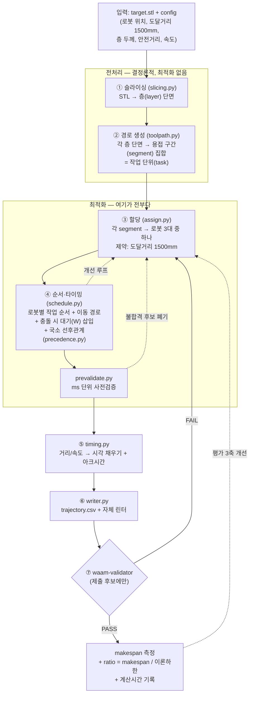

# IC-PBL 착수 가이드 — 멀티로봇 WAAM Makespan 최소화

> 작성 2026-09-13 · rev.2 2026-09-13 · **개정 rev.3 2026-10-06** · 레포 경로 `docs/playbook.md`
> 대상: [INE4107] 인공지능과알고리즘 IC-PBL (30%, 8주차 1차 / 15주차 최종)
>
> 📌 **rev.3 개정 사유**
> 1. **로컬 작업환경 구축 완료** — `C:\Github\waam-makespan`에서 Claude Code로 작업하는 체제로 전환 (§2, §3)
> 2. **rev.2의 미확정 2건이 확정됐다** — 층간 선후관계·아크 시간은 Validator가 **강제하지 않는다.** 그래서 우리가 스스로 부과한다 (§1-2, 부록)
> 3. 운영 설계(`docs/operations.md`)에서 정한 **모듈 착수 순서**를 Day 체크리스트에 합쳤다 (§2)
> 4. 환경 구축 중 실제로 부딪힌 **Windows 함정 목록** 추가 (§3-5)
> 5. **프로젝트 PDF 3편 정독 반영** (§4-3) — 내 초판 서술 정정 2건: Li 2024의 충돌 처리("swap area"는 공유 영역이 아니라 swept area), Poudel 2021("MILP"이 아니라 수정 GA)
>
> **수치·계약·사양의 단일 출처는 `docs/spec.md`(= `WAAM Validator 확정명세 + 작업환경`).** 이 문서는 *전략과 순서*를 담당한다. 어긋나면 spec.md가 맞다.

---

## 0. 시작 전에 — 이 문제의 정체를 먼저 규정하자

교수님 시뮬레이터는 **6축 관절을 다루지 않고 TCP(툴 끝점) 위치만 다루는 간소화 모델**이고, 제출물은 **`trajectory.csv` 하나**다. 이 두 사실이 문제의 성격을 결정한다.

> **이건 로봇 모션플래닝 문제가 아니라, 기하 제약이 붙은 "할당 + 스케줄링" 문제다.**
> 역기구학·관절 궤적·동역학은 전부 범위 밖. 우리가 정하는 것은 **누가(로봇) · 무엇을(용접 구간) · 언제(순서·타이밍) · 어디로 이동하며(경로)** 뿐이다.

그래서 이 과제는 9~13주차에 배우는 **조합최적화(그리디+로컬서치 / SA / GA / NCO)** 와 정확히 같은 형태다. 강화학습은 선택지 중 하나일 뿐, 필수가 아니다.

그리고 가장 중요한 원칙 하나:

> ⚠️ **Validator 소스코드가 곧 진짜 명세서다.** 문서보다 코드가 정확하다.
>
> ✅ **이 작업은 완료했다.** 충돌은 **Base→TCP를 잇는 XY 2D 캡슐**(중심선 간 ≥250mm, TCP 간 ≥200mm, Z 무시), 도달거리는 **XY 투영만**, makespan은 **로봇별 마지막 waypoint 시각의 최댓값**. rev.3에서 **층 선후관계(미강제)** 와 **아크 시간(미요구)** 도 코드 grep + 반증 실험으로 확정했다.

---

## 1. 전체 작업 흐름도

### 1-1. 파이프라인



단계별 성격:

| 단계 | 성격 | 난이도 | 점수 기여 |
|---|---|---|---|
| ① 슬라이싱 | 결정론적 전처리 | 낮음 (라이브러리) | 없음 |
| ② 경로 생성 | 결정론적 전처리 | 중간 | 간접 (segment 정의가 해공간을 결정) |
| **③ 할당** | **최적화** | **높음** | **직접** |
| **④ 순서·타이밍** | **최적화** | **높음** | **직접** |
| ⑤ 타이밍 채우기 | 배관(plumbing) | 중간 | 없음 |
| ⑥ CSV 출력 | 배관 | 낮음 | 없음 (단 형식 틀리면 전멸) |
| ⑦ 검증 | 게이트 | 낮음 | **통과 못하면 0점** |

> **레버리지는 ③④에 100% 있다.** ①②⑤⑥에 시간을 쏟는 건 낭비지만, 이게 없으면 ③④를 시작할 수도 없다. 그래서 ①②⑤⑥은 **최대한 빨리, 최대한 단순하게** 끝내고 ③④에 시간을 몰아야 한다.
> rev.3: 탐색 루프 안에서는 `waam-validator`를 부르지 않는다. **`prevalidate.py`가 ms 단위로 거르고**, Validator는 제출 후보에만 쓴다.

### 1-2. 문제를 쪼개는 핵심 가정 2가지 — rev.3 확정

**(a) 층간 선후관계 (layer precedence) — ✅ 확정: Validator는 강제하지 않는다**

초판은 "n층이 다 쌓여야 n+1층을 올린다 → 층별 서브문제로 분해"를 가정했다. 확인 결과:

- Validator의 형상 검증은 각 `D` 구간을 **Z만 보고 층에 배분해 합집합**할 뿐 `time_s`를 참조하지 않는다.
- 반증 실험: 층 순서를 완전히 뒤집은 tB가 정상 순서 tA와 **소수점까지 같은 결과로 PASS**.

→ **전역 barrier가 불필요**하고, **전체를 하나의 큰 할당·스케줄링 문제로 풀 수 있다** (불균형 손실이 층마다 누적되지 않고 전체에서 한 번만 정산).
→ 선행연구 Li et al.(2024)는 **한 층만 다루는 범위 설정**이다 (논문 스스로 "primary research"라며 flat layer만 고려). 층 순서 자체는 물리적 전제이지만 **이 Validator는 층 순서를 보지 않는다** — 그 분해를 그대로 따를 필요가 없다.

⚠️ **그러나 악용하지 않는다.** 생기원 박사님이 상용 SW로 교차검증한다. 공중에 뜬 층을 먼저 쌓는 해는 Validator는 통과해도 현실에서 성립하지 않는다. 그래서 **우리가 스스로 부과한다:**

> **국소 선후관계**: 어떤 구간을 층 `k`에 적층하려면, 그 구간 바로 아래(층 `k−1`, 같은 XY)가 **그 시각 이전에 이미 적층되어 있어야 한다.** 전역 barrier는 걸지 않는다(파이프라이닝 허용).

**(b) 충돌은 사실상 2D 문제 — ✅ 확정**
Z를 무시하는 **보수적 탑뷰** 판정이다. 도달거리 1500mm 원 3개의 교집합 = **공유 영역**. 실측 구조: 1대만 닿는 영역 41.2% / 정확히 2대 55.6% / 3대 3.2% / 아무도 0%. → **3개의 2자 교환 문제**이고, 56%의 공유 영역이 **유일한 조절 손잡이**다.

### 1-3. 시간 축 설계 — rev.2 정정 유지

> ❌ 초판은 "`trajectory.csv`는 타임스텝마다 한 줄이라 수십만 행"이라 썼으나, 실제로는 **waypoint(경로 꼭짓점) 목록**이다. 샘플 job은 **전체가 9행**. `max_time_step_s` / `max_tcp_step_mm`은 Validator가 충돌검사용으로 내부 샘플링할 때 쓰는 값이지 우리 출력 형식이 아니다.

- 각 행의 `mode`는 **"이 행부터 다음 행 직전까지"** 의 구간 동작이고, 구간 안은 선형보간. 즉 `A→B`를 적층하려면 **A 행**이 `D`다.
- **시간은 우리가 전부 채워야 한다.** Validator는 우리가 쓴 `time_s`를 믿고 속도(D 8mm/s, T 150mm/s, ±10%)를 **검사만** 한다. 어기면 FAIL.
- 시간에 **공백을 남기면 안 된다.** 모드별 시간 합 ≠ 완료시각이면 `ArithmeticError`로 죽는다. 빈 시간은 `W`로.
- 내부 표현은 **segment 리스트**. 타임스텝 루프는 필요 없다.

```python
Segment(robot_id=1, mode="D", start_time_s=4.0, end_time_s=14.0,
        start_xyz_mm=(0,0,2), end_xyz_mm=(80,0,2))
```

### 1-4. 아크 시간 — ✅ 확정: 요구되지 않지만 우리가 넣는다

`arc_on/off`는 Validator가 읽지 않는 참조값이다 (참조 4곳뿐: Optional 필드 정의 · UI 표시 · 문서). 넣어도 통과, 안 넣어도 통과, makespan만 정확히 삽입한 만큼 변한다.

**넣기로 결정.** 근거: ① 비용 작음 (윤곽 기준 1~11%, 대부분 1~2%) ② 최적화가 **적고 긴 연속 패스**를 선호하게 만듦 (실제 WAAM 품질과 같은 방향, Li 2024의 "start-arc points 감소"와도 일치) ③ 상용 SW 교차검증에서 어긋나지 않음.
⚠️ 위 비용은 **윤곽만 센 하한**이다. infill 지그재그 방식에 따라 스트라이크 수가 10~100배 달라질 수 있다 → `toolpath.py` 설계 시 최우선 확인 항목.
보고서에는 **넣은 경우/안 넣은 경우 makespan을 둘 다** 제시한다.

### 1-5. 개선 루프는 평가 3축과 1:1로 붙인다

매 실험마다 이 세 줄을 같이 기록한다 (`experiments/results.csv`). 하나만 보면 반드시 다른 데서 손해 본다.

```
run_id | 알고리즘 | 모델 | makespan | ratio | 계산시간 | Validator PASS/FAIL | (외부 STL 편차)
```

성능은 절대값이 아니라 **`ratio = makespan / 이론하한`** 으로 본다. 이론 하한(h): 01 0.08 · 02 0.18 · 03 0.14 · 04 4.8 · 05 22.5 · 06 0.46.

---

## 2. 진행 현황과 다음 체크리스트 (2026-10-06 기준)

### ✅ 완료

| 단계 | 내용 | 비고 |
|---|---|---|
| 명세 확정 | 레포 clone, 소스 정독, 사양·계약·makespan·충돌 모델 확정, 6모델 config md5 동일 검증 | `docs/spec.md` |
| 미확정 2건 해소 | 층 선후관계 미강제 / 아크 시간 미요구 (코드 + 반증 실험) | spec §8-2, §8-3 |
| 로컬 도구 | Git, **Python 3.11**(winget), **Claude Code 2.1.291**(네이티브 설치) | |
| 레포 분리 | `C:\Github\WAAM_Validator`(교수님, 읽기 전용) / `C:\Github\waam-makespan`(우리, Claude Code 실행 위치) | |
| 가상환경 | `.venv` 생성·활성화 확인, Validator `-e` 설치 + `scipy rtree networkx ortools pymoo matplotlib pandas pytest` | |
| **Validator 동작 확인** | `tests\fixtures\sample_job` 복사 → `waam-validator run` **exit code 0** | 로컬 PASS 확인 |
| 레포 뼈대 | `src\waam`, `experiments`, `docs`, `out`, `.claude\agents`, `.claude\skills` + `.gitignore` | 첫 커밋 `b241800` |
| Claude Code 설정 | `.claude\settings.json` + 서브에이전트 3 + 스킬 5 (`waam-` 접두) 생성 → 레포에 풀어둠 | `docs/operations.md` §2 |
| 규칙 파일 | `CLAUDE.md`(레포 루트) + `docs\spec.md` 배치 | 이름·위치 고정 — §3-5 |

### 🔲 지금 남은 것 (순서대로)

1. **나머지 docs 3개 저장** — `docs\playbook.md` · `docs\references.md` · `docs\operations.md` (이 갱신본)
2. **교수님 레포 읽기 전용 잠금** — `attrib +R C:\Github\WAAM_Validator\* /S` (Claude Code의 `Edit` deny는 임의 스크립트의 쓰기를 못 막는다)
3. **설정 커밋** — `git add .claude CLAUDE.md docs` → commit
4. **`claude` 첫 실행 + 4가지 점검** — 신뢰 수락 → `/permissions`에 deny 규칙 → 서브에이전트 질문으로 3개 확인(`/agents`는 제거됨) → `/waam-status` 에러 없음 → Validator `README.md` 수정 요청이 **거부**되는지
5. **1단계 모듈 착수** (아래 Day 2)

### Day 2: **최소 통과 해(Minimum Valid Solution)** 만들기 ← 진짜 첫 마일스톤

운영 설계 6-3의 **1단계(`geometry → prevalidate → segment → timing → writer`)** 와 같은 작업이다. 끝나면 **손으로 만든 1대짜리 해가 PASS** 나야 한다.

- [ ] `tests\fixtures\sample_job`의 `trajectory.csv`(9행)를 **골든 테스트**로 고정 — writer·timing이 이걸 재현해야 한다
- [ ] 로봇 **1대만** 쓴다. 나머지 2대는 `W`. **주차 위치 주의** — 대기 로봇도 공간을 차지하므로 home 좌표가 안전하다는 보장이 없다 (`prevalidate`가 잡아야 한다)
- [ ] `tests/03`(6층)으로. 층을 오름차순으로 쌓으면 국소 선후관계는 자동 충족 — 단 **아크 시간은 처음부터 반영** (`CLAUDE.md` 규칙: 생략하지 않는다)
- [ ] makespan이 형편없어도 상관없다. **PASS가 뜨는 것만이 목표.**
- [ ] PASS 뜨면 **즉시 커밋 + 태그.** 최악의 경우 제출할 수 있는 안전망이다.

왜 중요한가: CSV 형식·단위·좌표계·형상 일치도 — 이 네 가지 함정을 **최적화 로직이 없는 상태에서** 전부 털어낸다.

### Day 3: 기록 인프라 + 3대 베이스라인 (운영 설계 2~3단계)

- [ ] `lower_bound.py` → `experiments/run_all.py` → `results.csv` 스키마 → `tests/` 골든 테스트 ← **여기까지가 "숫자를 기록할 그릇"이고, 끝나는 순간이 자동화 시작점**
- [ ] `slicing.py` → `toolpath.py` → **`baseline_sector.py`** (120° 3분할, 비교군으로만)
- [ ] 6개 모델 전부 PASS + `ratio` 표 확보
- [ ] 간트차트(`gantt.py`)로 **D/T/W 비율을 눈으로 본다.** W가 크면 충돌 회피 설계, T가 크면 할당/순서가 문제.

> 이 시점에 8주차 1차 발표 재료는 이미 확보된 셈이다. 달력상 8주차는 대략 **10/20 전후**다 (9/1 = 1주차 단순 계산, 휴강 미반영 — **LMS로 확인**).

### 그 다음: 개선 순서

1. **Assigner/Scheduler 프로토콜**(`strategy.py`)을 먼저 박는다 — 전략은 끼워넣기만 하면 되고, 야간 스윕이 전략 이름으로 자동 순회한다.
2. **부하 균형** — 섹터 3분할은 비대칭 형상에서 깨진다. **전용 부하(41%)를 먼저 계산하고 공유 영역(56%) 배분으로 상쇄** → Li 2024 top k% 를 베이스라인으로 재현
3. **이동(T) 최소화** — 로봇별 순서를 TSP처럼 정렬
4. **대기(W) 최소화** — 충돌 예상 시 "멈추기" 대신 "순서 바꾸기"
5. **메타휴리스틱** (10~11주차 SA/GA 이후) — 할당+순서 동시 탐색
6. **일반화 검증** — 외부 STL로 성능 편차 확인

---

## 3. 환경 세팅 — 실제로 구축한 구성 (rev.3)

### 3-1. 로컬(Windows) — 실제 순서

```powershell
# 도구 (한 번만, 설치 후 새 PowerShell을 열어야 PATH가 잡힌다)
winget install Python.Python.3.11
irm https://claude.ai/install.ps1 | iex            # Claude Code 네이티브 설치

# 레포 두 개
cd C:\Github
git clone https://github.com/Ha-An/WAAM_Validator.git
mkdir waam-makespan; cd waam-makespan; git init

# 우리 환경 (Validator는 -e 로 참조)
py -3.11 -m venv .venv
Set-ExecutionPolicy -Scope CurrentUser RemoteSigned   # Activate.ps1 차단 해제 (1회)
.\.venv\Scripts\Activate.ps1
python -c "import sys; print(sys.prefix)"             # ← .venv 경로가 나와야 한다
python -m pip install -U pip
python -m pip install -r C:\Github\WAAM_Validator\requirements.lock
python -m pip install -e C:\Github\WAAM_Validator --no-deps
python -m pip install scipy rtree networkx ortools pymoo matplotlib pandas pytest
waam-validator run .\tests\fixtures\sample_job        # exit code 0 확인 ($LASTEXITCODE)
```

**Claude Code는 이 PowerShell(venv 활성화 상태)에서 실행한다.** 그래야 `python`·`waam-validator`가 .venv 것으로 잡힌다.

```powershell
cd C:\Github\waam-makespan
claude
```

`--add-dir`은 필요 없다 — `settings.json`의 `additionalDirectories`가 Validator 읽기 권한을 준다 (`docs/operations.md` §2-1).

> ⚠️ **버전 고정.** 제출 후 교수님이 재현했을 때 "얼토당토않게" 나오면 FAIL이다. 최종 제출 직전 `pip freeze > requirements.lock.txt`. (아직 안 만들었다 — 체크리스트에 올려둘 것)

### 3-2. Colab vs 로컬 vs 클라우드 세션 (rev.3 역할 갱신)

| | 역할 |
|---|---|
| **로컬 PC (Claude Code)** | **코드 작성·실행·실험·야간 배치 전부.** 계산시간 공식 측정도 여기서 한 대로 고정 |
| 이 Claude 프로젝트 / 클라우드 세션 | 설계 논의, 문서 갱신, 보고서·발표, 결과 대시보드 **아티팩트** 발행 |
| Colab | 코드 공유·시연용으로만 (런타임 끊김, 하드웨어 변동) |

평가 2축이 **계산시간**이므로, **모든 공식 측정은 동일한 로컬 머신 한 대**에서 수행하고 보고서에 사양(CPU/RAM)과 측정 방법을 명시한다. 클라우드에서 잰 숫자는 설계 판단용 참고치일 뿐 보고서에 넣을 수 없다.
(`spec.md` §1-2의 "클라우드에서 프로토타이핑" 분담은 로컬 체제로 대체됐다 — 둘 사이 동기화는 **GitHub 레포 하나**.)

### 3-3. 개발 도구

교수님이 1주차에 권장한 **IDE/터미널에 embed한 AI 코딩 에이전트**를 그대로 쓴다. 우리는 **PowerShell + Claude Code CLI**다 (데스크톱 앱과는 별개). 브라우저 챗에 복붙하는 방식은 워크스페이스 맥락을 못 봐서 비효율적이라고 교수님이 명시적으로 지적하셨다.

### 3-4. 레포 구조 (실제)

```
C:\Github\
├─ WAAM_Validator\          ← 교수님 레포. 읽기 전용. 절대 수정 금지
└─ waam-makespan\           ← 우리 레포. Claude Code는 여기서 실행
   ├─ CLAUDE.md             # 규칙·사실만. 매 세션 로드 (루트에, 이 이름 그대로)
   ├─ .claude\              # settings.json · agents\ · skills\
   ├─ src\waam\
   │  ├─ config.py  geometry.py  prevalidate.py  segment.py  precedence.py
   │  ├─ slicing.py  toolpath.py  assign.py  schedule.py  timing.py  writer.py
   │  └─ lower_bound.py   (+ strategy.py: Assigner/Scheduler 프로토콜)
   ├─ experiments\          # run_all.py · sweep.py · results.csv
   ├─ tests\fixtures\sample_job\   # 골든 레퍼런스 (config·trajectory·target.stl)
   ├─ docs\                 # spec · playbook · references · operations · experiments(.md)
   ├─ out\                  # trajectory.csv 6개 (제출물)
   └─ .venv\
```

> **시드 고정**(`numpy`, `random`) + `python -m experiments.run_all --all` 한 줄로 6개 모델 전부 재현. 재현성은 제출 요건이다. 제출물에는 `logs/`도 포함해야 한다 (규정: 실행 로그).

### 3-5. (rev.3 신설) 실제로 부딪힌 Windows 함정

| 증상 | 원인 | 해결 |
|---|---|---|
| `py` / `claude` 를 찾을 수 없음 | 설치 직후 열려 있던 셸의 PATH가 갱신 안 됨 | **새 PowerShell**을 연다 |
| Claude 설치 중 "다른 프로세스가 파일 사용 중" | 설치 스크립트를 두 번 실행 | 한쪽이 끝나길 기다리거나 `claude*` 프로세스 종료 후 재시도. 안 되면 `winget install Anthropic.ClaudeCode` |
| `Activate.ps1` 실행 차단 | 실행 정책 | `Set-ExecutionPolicy -Scope CurrentUser RemoteSigned` (프롬프트 없이 넘어가도 정상일 수 있다 — 아래 확인) |
| 패키지가 전역 Python에 설치됨 | 활성화 실패 상태에서 `pip install` | `python -c "import sys; print(sys.prefix)"`가 `.venv`인지 **설치 전에** 확인 |
| `Expand-Archive` 경로 없음 | zip을 아직 다운로드하지 않았거나 이름이 `(1)`로 바뀜 | `dir "$HOME\Downloads\waam*"`로 실제 이름 확인 |
| `CLAUDE.md`가 로드 안 됨 | `.claude\` 안에 있거나 파일명이 `CLAUDE.md (레포 루트용 프롬프트).md`처럼 다름 | **레포 루트**에 정확히 `CLAUDE.md` |
| 메모장 저장이 `.md.txt` | 파일 형식이 "텍스트 문서" | 저장 창에서 "모든 파일" + 인코딩 UTF-8, 또는 `Move-Item`으로 이름 교정 |
| `docs\` 파일명 불일치 | CLAUDE.md가 `spec.md`·`playbook.md`·`references.md`·`operations.md`·`experiments.md`로 참조 | 이름 고정 |

---

## 4. 이미 존재하는 코드·라이브러리·논문

### 4-1. 결론부터

> **이 과제를 그대로 풀어주는 오픈소스는 없다.** 문제·시뮬레이터·CSV 포맷이 교수님이 이번에 직접 만든 것이라 공개 구현이 존재할 수 없다.
> 하지만 **각 단계의 부품과, 바로 베껴 쓸 수 있는 알고리즘 아이디어는 충분히 있다.**

### 4-2. 단계별 재사용 부품 — rev.2 재평가 유지

#### 실제로 쓴다 (설치 완료)

| 단계 | 도구 | 왜 / 어떻게 |
|---|---|---|
| ① 슬라이싱 | **[trimesh](https://github.com/mikedh/trimesh)** ⭐⭐⭐ | `mesh.section_multiplane(origin, normal, heights)` → `.polygons_full`(shapely 폴리곤). **6개 모델의 층수·단면적·이론 하한을 이미 이걸로 뽑았다.**<br>⚠️ `.area` / `.polygons_full`은 **scipy와 rtree가 없으면 런타임에 죽는다** (Validator lock에 없음 → 별도 설치, 우리 환경엔 설치 완료) |
| ② 경로 생성 | **shapely** ⭐⭐⭐ | 윤곽 오프셋(`buffer`), 내부 채움용 직선 교차. 비드 폭 8mm. **infill을 어떻게 이어 긋는지가 아크 스트라이크 수(= 아크 비용)를 좌우한다** (§1-4) |
| ③④ **하한 산출** | **[OR-Tools CP-SAT](https://developers.google.com/optimization/scheduling/job_shop)** ⭐⭐⭐ | flexible job shop과 구조 1:1 (job = 세그먼트, machine = 로봇 3대, flexible = 도달범위). **충돌 제약을 넣을 수 없으므로 "해를 만드는" 용도가 아니라 "하한을 구하는" 용도** — 충돌을 무시한 완화 문제의 해 = "충돌만 없다면 가능한 최선". 보고서에 넣으면 강력 |
| ③④ 메타휴리스틱 | **[pymoo](https://pymoo.org/)** ⭐⭐ | GA/NSGA-II 기성 구현. 11주차 GA와 연결 |

#### 조건부

**[PySLM](https://github.com/drlukeparry/pyslm)** ⭐⭐ — trimesh는 윤곽까지만 주고 그 안을 채우는 **해칭**은 우리가 만들어야 한다. SLM(레이저+분말)용이라 WAAM 파라미터 감각과 다르다. **아이디어 참고용**.

#### 뺀다

| 도구 | 왜 뺐나 |
|---|---|
| ~~atb033/multi_agent_path_planning (CBS)~~ | 우리 충돌 모델은 격자 MAPF가 아니라 **Base–TCP 캡슐의 연속 XY 판정**. "충돌 시 누가 양보할지 우선순위로 정한다"는 발상만 남김 |
| ~~RL4CO~~ | env 재작성 비용이 크다. 시간이 남을 때의 선택지 |
| ~~rpiRobotics/Convergent_Manufacturing_WAAM~~ | scan-n-print용, makespan 최적화 없음. 아키텍처 쪽이면 `Welding_Motoman` |
| stable-baselines3 | RL로 갈 때만. 보류 |

### 4-3. 논문 — 프로젝트에 PDF 3편 확보 (rev.3)

프로젝트에 PDF가 있다: **Li et al. 2024** · **Oh 2020 taxonomy** · **Oh & Cho 2022**. 읽기 상태와 인용 위치는 `docs/references.md` §6. **세 편 모두 2026-10-06 전문 정독 완료.**

**① Li et al. (2024) — 이 과제와 가장 가까운 선행연구** ⭐ *(2026-10-06 전문 정독 — 상세·비교표는 `docs/references.md` §5-3)*
*"Allocation and scheduling of deposition paths in a layer for multi-robot coordinated wire and arc additive manufacturing of large-scale parts"*, **Virtual and Physical Prototyping 19(1), e2300680 (2024)**, [doi:10.1080/17452759.2023.2300680](https://doi.org/10.1080/17452759.2023.2300680) (오픈액세스)

- 문제: **한 층 안**의 raster 경로를 로봇에 할당 + 순서 + 충돌 회피. 어려움은 순열 폭발 (식 12)
- **top k%**: 로봇별 **도달 가능 경로 창고(PW)** 를 로봇–경로 중심 거리로 정렬 → 매번 **작업량이 가장 적은 로봇**에게 `k·T_pw/100`만큼 **가까운 순서로** 할당 → 반복. **k는 하이퍼파라미터** (작을수록 균등도 EWL↑ · 인접도 GOA↓, 논문 실험은 k=35)
- 스케줄링: 인접 경로를 묶은 **DT**로 대상을 줄이고, 로봇이 동시에 일하는 **WP**마다 **swept area(안전반경 50 mm 직사각형)** 겹침을 검사, DT 순서는 **순열 전수 열거**
- 결과: **SEM 92.1%**, turns 127 · 아크 시작점 10 (비교 방법 183 / 293 turns). 할당 계산시간 0.011~0.027 s

> 👉 **베이스라인을 120° 섹터 3분할 대신 top k%로 잡는 것을 권한다.** 단 **그대로는 못 쓴다** — 그쪽은 ① 한 층 ② **이동시간 무시** ③ 아크 시간 미반영 ④ TCP 원 기반 SA 충돌 모델이다.
> 우리는 **PW + "가장 한가한 로봇에게 가까운 순서로 k%"** 라는 할당 규칙만 가져오고, 부하 계산에 이동·아크 시간을 넣고, 충돌은 `prevalidate`(캡슐)로 판정한다. **SEM = 1/ratio** 이므로 같은 눈금으로 보고할 수 있다 (`references.md` §7).

**② Arbogast et al. (2024)** — *Strategies for a scalable multi-robot large scale wire arc additive manufacturing system*, **Additive Manufacturing Letters 8: 100183**, ORNL MedUSA. 보고서 배경/동기 절.

**③ Poudel, Zhou & Sha (2021), Resource-Constrained Scheduling for Multi-Robot Cooperative 3D Printing**, *ASME J. Mech. Des.* 143(7), 072002 — **정정(rev.3)**: 초판은 "MILP 계열"이라 썼으나 Li 2024는 이를 *chunk 분해 + 증착 순서 관리를 하는 수정 GA*로 서술한다. **원문 미열람** — 선행연구 후보로만 분류하고 인용 전 확인. 관련: McPherson & Zhou (2018, *Rapid Prototyp. J.* 24(9)) *A chunk-based slicer for cooperative 3D printing* — Li 2024의 충돌 제약(식 15)이 이 연구를 수정한 것.

**④ He et al. (2024/25) — [rpiRobotics/Welding_Motoman](https://github.com/rpiRobotics/Welding_Motoman)**, [arXiv:2408.04677](https://arxiv.org/abs/2408.04677) — 멀티로봇 WAAM 오픈소스 아키텍처. **makespan 최적화는 다루지 않는다.** 슬라이싱·아키텍처 참고용.

**⑤ 오요셉 교수 본인 논문** — 19편 중 쓸 자리가 있는 것만 선별 → `docs/references.md`.
- **Oh et al. (2020) taxonomy**, *Additive Manufacturing* 36, 101492 — [NIST PDF](https://tsapps.nist.gov/publication/get_pdf.cfm?pub_id=930053). 우리 문제를 교수님 분류체계에 위치시키는 데. **정독 결과**: Table 1이 scheduling을 machine-level("builds를 AM machines에 배정")로 정의하고, §2.1이 기계 내부(micro-level) 스케줄링을 범위에서 제외하며, §4.2가 multi-laser·multi-extruder 확장을 future work로 언급한다. **표 5~9의 53편 어디에도 DED 행이 없다.**
- **Oh & Cho (2022)**, *Additive Manufacturing* 59, 103164 — **내용보다 형식**(정식화 표기·평가지표·결과 제시)을 빌린다. **정독 결과**: Table 1 표기표 · indicator constraint · MIP1~3 · **MIP gap · reduction rate** · 10파트 43.7 h(CPU/RAM 명시) → 우리 표기·`ratio`↔gap 환산·계산시간 보고 방식에 직접 쓴다 (`references.md` §1 ②, §7).

### 4-4. 보고서용 한 줄

> "선행연구는 층 내 할당(Li et al. 2024)과 하드웨어 아키텍처(He et al. 2024)를 각각 다루지만, **간소화 TCP 모델 위에서 makespan·계산시간·일반화를 동시에 만족하는 접근**은 비어 있다. 우리는 Validator가 검사하지 않는 물리 제약(층 선후관계·아크 시간)을 식별해 스스로 부과하고, 그 비용을 정량화했다."

생기원 박사님이 함께 평가한다는 점을 기억할 것.

---

## 5. 흔한 실패 모드 (미리 피하기)

| 실패 | 왜 생기나 | 예방 |
|---|---|---|
| 마감 직전 Validator FAIL | 최적화부터 만들고 검증을 뒤로 미룸 | **Day 2에 1대짜리 PASS 해 확보** |
| 계산시간에서 밀림 | 후보 평가마다 전체 시뮬레이션 / 탐색 루프 안에서 Validator 호출 | segment 리스트 + **`prevalidate.py`로 거르고 Validator는 제출 후보에만** |
| 3번 모델만 잘 나옴 | 특정 STL에 맞춘 파라미터 튜닝 | 외부 STL 상시 교차검증, **tests/NN 하드코딩 금지** (`waam-reviewer`가 검사) |
| 재현 시 결과 불일치 | 시드 미고정, 버전 미고정 | 시드 + `requirements.lock.txt` + 한 줄 재현 스크립트 |
| **Validator만 통과하는 비물리 해** | 선후관계·아크 시간이 미강제임을 악용 | **국소 선후관계 + 아크 시간을 스스로 부과** (`precedence.py`, `timing.py`) |
| **Claude Code가 교수님 레포를 수정** | 권한 설정 누락 / deny 규칙 문법 오류 | `Edit(//c/Github/WAAM_Validator/**)` deny + `attrib +R` 이중 방어, 첫 실행 때 수정 거부 테스트 |
| **규칙 파일이 로드 안 됨** | 위치·이름 오류 | §3-5 표 |
| 주차 위치 충돌 | 먼저 끝난 로봇의 주차 위치도 끝까지 검사 | 주차 위치를 **최적화 변수**로 취급, `prevalidate`에 포함 |
| 팀 내 병목 | 한 명이 전 파이프라인 담당 | ①②⑤⑥(배관) / ③④(최적화) / 실험·보고서로 분리, 인터페이스(프로토콜)만 먼저 합의 |
| 무임승차 논란 | 기여 추적 불가 | 커밋 단위로 작업 분리, 동료평가 대비 |

---

## 6. 다음 액션 — rev.3 기준

1. ~~레포 clone → Validator 소스 읽기 → 명세 문서 작성~~ ✅
2. ~~층간 선후관계 강제 여부 확인~~ ✅ **미강제 → 국소 선후관계 자체 부과**
3. ~~arc 시간 요구 여부 확인~~ ✅ **미요구 → 우리가 넣는다**
4. ~~로컬 환경 구축 + sample_job PASS~~ ✅
5. **docs 3개 저장 → attrib 잠금 → 설정 커밋 → `claude` 첫 실행 4점검** ← 지금
6. **1단계 모듈 착수** — `geometry → prevalidate → segment → timing → writer` → 1대짜리 PASS (Day 2)
7. 2단계 `lower_bound → results.csv → tests` → 3단계 `slicing → toolpath → baseline_sector` → 4단계 Li 2024 top k% 베이스라인

---

## 부록: 미확정 항목 — rev.3 갱신

### ✅ 확정됨 (상세는 `docs/spec.md`)

| 항목 | 확정 내용 |
|---|---|
| `trajectory.csv` 스펙 | `robot_id,time_s,x_mm,y_mm,z_mm,mode` 6컬럼 고정, waypoint 목록 |
| 충돌 판정 기하 | Base→TCP **XY 2D 캡슐**. 중심선 ≥250mm, TCP ≥200mm, **Z 무시**, 대기·주차 로봇도 검사 |
| 도달거리 | **XY 투영만**, 1500mm |
| 속도 | 적층 8mm/s, 이동 150mm/s, ±10% 검사, **`fail_on_speed_violation: true`** |
| 형상 기준 | Coverage ≥80%, Overfill ≤30%, 전체 IoU ≥90%, layer IoU ≥80%, 실패 layer ≤5% |
| makespan 정의 | **로봇별 마지막 waypoint 시각의 최댓값** |
| **층 선후관계** | **Validator 미강제** (tA/tB/tC 실험) → 국소 선후관계 자체 부과 |
| **arc_on/off** | **Validator 미요구·미금지** (tA/tD 실험) → 우리가 반영, 비용 윤곽 기준 1~11% |
| 샘플 해 | `examples/sample_job/` 3종 → 로컬 `tests\fixtures\sample_job`에 복사, **PASS 확인** |

### ❓ 아직 남은 것

- [ ] 보고서 템플릿 (교수님 미배포 — LMS 확인)
- [ ] **infill 이어 긋기 방식에 따른 아크 스트라이크 수** — 윤곽 기준 하한만 알고 있다 (§1-4)
- [ ] 8주차 정확한 날짜 (휴강 반영)
- [ ] KAMIC 현장 방문 일정·질문 목록 (9월 중 예정이었음 — 진행 여부 확인)
- [ ] `requirements.lock.txt` 생성 (제출 직전)
- [ ] 미열람 선행연구 확인 — Jin et al. 2019(IISE Trans.), Poudel et al. 2021 (`references.md` §6)
- [ ] 보고서용 하한 LB1 (reach 반영 CP-SAT 완화) — Oh & Cho식 gap 표기에 필요 (`references.md` §7)
